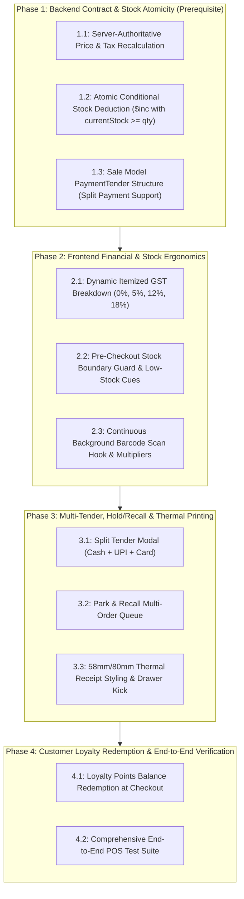

# POS MODULE — PHASE 0 ARCHITECTURAL AUDIT & BASELINE REPORT

**Project:** Grocery Management System  
**Workspace:** `C:\Users\Siddheshwar\Desktop\grocery\grocery_management_system`  
**Target Module:** `frontend/pos.html` (Point of Sale Interface)  
**Backend Controllers Inspected:** `SaleController.java`, `ProductController.java`, `CustomerController.java`  
**Backend Models Inspected:** `Sale.java`, `Product.java`, `Customer.java`, `InventoryTransaction.java`  
**Audit Mode:** STRICT READ-ONLY ARCHITECTURAL INSPECTION & BASELINE  
**Audit Date:** 2026-11-26  
**Status:** COMPLETE (Zero source code, database records, or configuration modified)

---

## 1. EXECUTIVE SUMMARY

An in-depth, read-only architectural audit of the Point of Sale (POS) module was conducted across frontend presentation (`pos.html`, `pos.css`), client-side state handling, backend API contracts (`SaleController`), data integrity rules, and database transaction guarantees.

### Key Audit Findings:
1. **Critical Financial Divergence (Client-Trusted Totals):**
   - The backend `POST /api/v1/sales` currently **trusts client-supplied financial totals** (`subtotal`, `taxAmount`, `grandTotal`, `discountAmount`). While `Product.costPrice` is authoritatively resolved on the server, `unitPrice` and `grandTotal` are not independently verified or re-computed on the server, allowing potential payload tampering or rounding drift.
   - The frontend hardcodes a flat `5% GST` (`CGST 2.5% + SGST 2.5%`), ignoring each product's specific catalog `taxRate` (which varies across 0%, 5%, 12%, 18%).
2. **Stock Concurrency & Overselling Defect (Non-Atomic Stock Read-Modify-Write):**
   - Lines 132–135 of `SaleController.java` mutate stock using a non-atomic read-modify-write pattern:
     ```java
     double newStock = Math.max(0, product.getCurrentStock() - item.getQuantity());
     product.setCurrentStock(newStock);
     productRepository.save(product);
     ```
   - Concurrent checkouts of the same item can interleave, losing stock decrements. Furthermore, `Math.max(0, ...)` silently caps negative balances to zero without rejecting oversold carts!
3. **Absence of Split Payments in Data Model:**
   - The `Sale.java` model contains a single scalar `private String paymentMethod = "CASH";` (and `tenderedAmount`, `changeDue`). There is **zero data structure** for multiple tender splits (e.g. ₹500 Cash + ₹250 UPI). Supporting split tender requires introducing a structured `PaymentTender` breakdown.
4. **Barcode Scanning Ergonomics:**
   - Scanner input relies entirely on focus remaining in `#pos-barcode-input`. If a cashier clicks the cart or touches the screen, scanner inputs are dropped or swallowed. Quantity multipliers (e.g., `5*BEV-001`) are unsupported.
5. **No Cart Hold/Park Functionality:**
   - Carts live solely in a single volatile JavaScript array (`cart = []`). If a customer steps away, the cashier has no way to park the ticket without either abandoning the queue or clearing the cart.
6. **Loyalty Accrual vs. Redemption:**
   - The backend awards loyalty points on checkout (`targetCustomer.setLoyaltyPoints(...)`), but **zero redemption logic** exists on either the frontend or backend checkout endpoints.

---

## 2. FRONTEND POS AUDIT (`frontend/pos.html`)

### A. Product Catalog & Fetching
- **Endpoint:** `Api.get('/products?status=ACTIVE')` in `initPos()` (Line 482).
- **Tenant Context:** Inherited via `Authorization: Bearer <token>` in `Api.get()`. Backend isolates products by authenticated `storeId`.
- **Filtering:** Filters by category pill clicks (`selectedCategory`).
- **Catalog Rendering:** Products render as card tiles with icon, name, SKU, price, and stock count.
- **Defects / Risks:**
  - In large supermarket catalogs (1,000+ items), fetching all active products into an unpaginated in-memory grid causes high DOM node counts and initial load delays.
  - Search matches `name`, `sku`, and `barcode` across client-side memory, which is responsive for $< 500$ items, but lacks server-side pagination for large inventories.

### B. Barcode Scanning
- **Mechanism:** Text `<input id="pos-barcode-input">` listening on `keydown` for `Enter`.
- **Defects / Risks:**
  - **Focus Dependency:** Hardware scanners emulate keystrokes followed by `[ENTER]`. If the focus is outside the input box, scans are lost.
  - **No Quantity Prefix:** Scanning 10 cans of soup requires 10 physical scans or clicking `+` 9 times. Prefix multipliers (`10*BARCODE`) are not parsed.
  - **Scanner Rate Handling:** Rapid keystrokes from USB/Bluetooth scanners do not have a dedicated timing buffer to distinguish scanner input from manual typing.

### C. Cart Integrity & State Management
- **Cart Structure:** Array of objects: `{ productId, productName, sku, unitPrice, unit, quantity, total }`.
- **Calculation Flow:** `calculateCartTotals()` computes:
  - `subtotal = sum(item.total)`
  - `discountAmount = (subtotal * discountPct) / 100`
  - `taxableAmount = subtotal - discountAmount`
  - `cgst = taxableAmount * 0.025` (Hardcoded 2.5%)
  - `sgst = taxableAmount * 0.025` (Hardcoded 2.5%)
  - `grandTotal = taxableAmount + cgst + sgst`
- **Defects / Risks:**
  - Cart calculations do not account for individual product tax exemptions or higher tax brackets.
  - No client-side stock capping: clicking `+` allows incrementing quantity above `prod.currentStock`.

### D. Stock Validation
- **Current Observation:**
  - Catalog card shows `Stock: X`.
  - When adding to cart, `addToCart(product)` does **not** check whether `existing.quantity + 1 > product.currentStock`.
  - The cashier is allowed to proceed to payment with quantities exceeding inventory.
  - At server checkout, the backend does not reject the transaction—it silently clamps `newStock = Math.max(0, ...)`!

### E. Financial & GST Calculations
- **Confirmed Defect:** Hardcoded 2.5% CGST + 2.5% SGST.
- In Indian GST for groceries:
  - Grains, fresh vegetables, fresh milk: **0% (Exempt)**
  - Edible oils, packaged spices, tea: **5%**
  - Butter, cheese, frozen foods: **12%**
  - Chocolates, soft drinks, detergents: **18%**
- Applying a blanket 5% violates tax compliance and misstates invoice taxes.

### F. Checkout & Payment
- **Tender Modal:** Supports tabs for `CASH`, `UPI`, `CARD`.
- **Payload Sent (`POST /api/v1/sales`):**
  ```json
  {
    "subtotal": 100.0,
    "discountAmount": 0.0,
    "taxAmount": 5.0,
    "grandTotal": 105.0,
    "paymentMode": "CASH",
    "customerName": "Walk-in Customer",
    "customerPhone": null,
    "items": [{ "productId": "...", "quantity": 1, "unitPrice": 100.0, "total": 100.0 }]
  }
  ```
- **Confirmed Gap:** Single scalar payment mode. No split tender capability.
- **Duplicate Checkout Guard:** The button disables with `Processing...`, which prevents rapid double-clicks on the frontend, but lacks an idempotent transaction key on the backend request.

### G. Customer & Loyalty
- **Lookup:** Triggers on mobile number blur (`GET /customers/phone/{phone}`).
- **Display:** Displays customer name, tier, and points balance (`✓ Found: John (Tier: SILVER, Points: 150)`).
- **Defect:** No UI or API mechanism to redeem points toward the bill.

### H. Hold & Recall
- **Confirmed Gap:** No parked order or cart suspension mechanism exists. Carts are entirely volatile.

### I. Receipt & Printing
- **Implementation:** Custom HTML thermal template rendered in `#thermal-receipt-content` invoked via `@media print`.
- **Formatting:** Monospace layout with dotted dividers.
- **Defects / Risks:**
  - No ESC/POS raw printing support for hardware roll cutters or cash drawers.
  - Receipt width is bounded to `360px`, but page margins in generic browser print dialogs can cause unwanted page breaks on continuous roll printers (58mm/80mm).

---

## 3. BACKEND CONTRACT AUDIT (`SaleController.java` & Models)

### A. Endpoint Contract (`POST /api/v1/sales`)
- **Required Fields:** `items` (at least 1 item with valid `productId` belonging to authenticated store).
- **Validation Performed:**
  - Store ownership check: `productRepository.findByStoreIdAndId(storeId, item.getProductId())`.
  - Active status check: `product.getStatus() === "ACTIVE"`.
  - Customer store ownership check (if `customerId` or `customerPhone` provided).
- **Defects & Architectural Gaps:**
  1. **Unverified Financial Totals:** The backend does not verify `unitPrice`, `subtotal`, `taxAmount`, or `grandTotal`. It directly assigns client-supplied totals to the persisted `Sale` document.
  2. **Non-Atomic Stock Read-Modify-Write:**
     ```java
     double newStock = Math.max(0, product.getCurrentStock() - item.getQuantity());
     product.setCurrentStock(newStock);
     productRepository.save(product);
     ```
     - Vulnerable to lost updates under concurrent checkouts.
     - `Math.max(0, ...)` permits overselling without throwing an error.
  3. **Non-Transactional Multi-Document Writes:**
     - The controller updates `Product`, creates `InventoryTransaction`, creates `Notification`, updates `Customer`, and saves `Sale`.
     - None of these writes are wrapped in `@Transactional` or a client session. A server crash or MongoDB error midway leaves stock deducted without a recorded `Sale`.
  4. **Payment Schema Inflexibility:**
     - `Sale.java` only has `paymentMethod` (String). It cannot store split payments (e.g. `[{ mode: "CASH", amount: 200 }, { mode: "UPI", amount: 150 }]`).

---

## 4. BASELINE TEST AUDIT

An inspection of the backend test directory (`backend/src/test/java/com/grocery/`) reveals:
- **Available Test Classes:**
  - `AuthBrutalTest.java` (Authentication & JWT tests)
  - `ProductControllerTest.java` (Product lifecycle, status, categories — 26 tests)
  - `ProductCreationBrutalTest.java` (Adversarial product creation — 23 tests)
  - `MultiTenantIsolationTest.java` (Multi-tenant store data leaks)
  - `DashboardStage2Test.java` through `DashboardStage2_6Test.java` (Analytics metrics)
- **POS / Sales Test Gap:**
  - There is currently **zero dedicated test coverage** for `SaleController.java`, checkout stock deduction, or return idempotency.
  - No integration tests exist verifying concurrent checkouts, overselling prevention, or tax recalculation.

---

## 5. GAP ANALYSIS (POS-GAP-01 through POS-GAP-07)

| Gap ID | Description | Severity | Risk to Operations | Financial Risk | Stock Integrity Risk | Recommended Architecture & Remediation |
|---|---|---|---|---|---|---|
| **POS-GAP-01** | Dynamic GST Calculation | **CRITICAL** | Low | **HIGH** (GST non-compliance, inaccurate tax filing) | None | Calculate itemized GST dynamically from `product.taxRate` on frontend AND re-calculate authoritatively on backend. |
| **POS-GAP-02** | Stock Boundary Enforcement | **HIGH** | Medium (Cashier friction) | Medium | **CRITICAL** (Overselling, unrecorded negative stock) | Pre-checkout frontend quantity cap (`qty <= product.currentStock`) + Server-side atomic conditional deduction (`$inc: -qty` where `currentStock >= qty`). |
| **POS-GAP-03** | Split Tender Processing | **HIGH** | High (Cashier unable to split bill across Cash & UPI) | Low | None | Expand `Sale.java` with `List<PaymentTender> tenders`; update tender modal with split input fields. |
| **POS-GAP-04** | Continuous Barcode Scan Hook | **MEDIUM** | High (Slow checkout lines, missed scans) | Low | Low | Global window keystroke buffer with timing threshold ($\le 50$ms between characters) to route scanner inputs to cart regardless of focus. |
| **POS-GAP-05** | Order Hold & Recall | **MEDIUM** | High (Checkout line stalled when customer leaves) | Low | Low | Multi-ticket session/local storage queue (up to 5 parked orders) with 1-click park and recall. |
| **POS-GAP-06** | Loyalty Points Redemption | **MEDIUM** | Medium (Customer dissatisfaction) | Medium | None | Server-validated points redemption: `100 points = ₹X discount`; atomic point deduction during checkout transaction. |
| **POS-GAP-07** | Thermal Print & ESC/POS Fit | **LOW** | Medium (Misaligned thermal receipts) | Low | None | Dedicated 58mm/80mm print media query, page-break suppression, and optional ESC/POS drawer kick byte string. |

### Additional Discovered Defect:
- **POS-DEF-08: Server Price & Total Trust Vulnerability:**
  - Severity: **CRITICAL**
  - Defect: Backend `POST /sales` accepts client-calculated `grandTotal` and `subtotal`. A tampered HTTP payload can purchase a ₹1,000 item for ₹1.00.
  - Fix: Server must calculate line totals (`quantity * product.getSellingPrice()`), apply verified discounts, compute taxes, and derive authoritative `grandTotal`.

---

## 6. IMPLEMENTATION DEPENDENCY ANALYSIS

Attempting to implement frontend enhancements (such as split tender or loyalty redemption) before hardening the backend contract would result in broken transactions or data loss.



---

## 7. RECOMMENDED PHASE 1 IMPLEMENTATION SCOPE

To establish a solid, unbreakable foundation, **Phase 1** must focus on:
1. **Backend Financial & Stock Hardening:**
   - Server-side calculation of `subtotal`, item-level taxes, and `grandTotal` (overriding untrusted client totals).
   - Atomic conditional stock deduction to prevent overselling and concurrency race conditions.
   - Updating `Sale.java` to support split tender arrays.
2. **Frontend Dynamic GST & Stock Guards:**
   - Dynamic tax computation according to product `taxRate`.
   - Cart quantity limits capped to available stock with real-time cashier notifications.

---

## 8. ATTESTATION & COMPLIANCE

- **Read-Only Verification:** Exactly `0` backend files, frontend files, tests, database records, or configuration settings were modified during this Phase 0 audit.
- **Database Safety:** Production database `grocery_db` was not contacted.
- **Deliverable Status:** Audit completed and documented in `POS_PHASE_0_ARCHITECTURAL_AUDIT_REPORT.md`.
